# BrickGame

## Chapter I
## General information

BrickGame is a popular handheld console from the 90s with several ~~thousands~~ of built-in games developed in China. It was originally a copy of Tetris developed in the USSR and released by Nintendo as part of the GameBoy platform, but also included many other games that were added over time. The console had a small screen with a 10x20 playing field that was a matrix of "pixels". To the right of the field was a scoreboard with a digital display of the current game status, records, and other additional information. The most popular games on BrickGame were Tetris, Tanks, Racing, Frogger and Snake.

### History

Tetris was created on an Electronica-60 computer by Alexey Pajitnov on June 6, 1984. The game was a puzzle based on the use of "tetraminoes" — shaped pieces consisting of four squares. The first commercial version of the game was released in the United States in 1987. In the following years, Tetris was ported to many different devices, including mobile phones, pocket calculators and PDAs.

The most popular version of Tetris is the one for the Game Boy and NES consoles. But there are several other versions of the game. For example, there's a version with three-dimensional pieces, or a duel version where two players get the same pieces and try to beat each other in scoring.

### Finite-state machines

A finite-state machine (FSM) in algorithm theory is a mathematical abstraction, a model of a discrete device that has an input, an output, and is in one of a set of possible states at any given time.

During operation, the input of the FSM receives input actions sequentially, and the output of the FSM generates output signals. Transition from one internal state to another can occur not only by external action, but also spontaneously.

FSM can be used to describe algorithms for solving specific problems, as well as to model almost any process. Some examples:

- Artificial intelligence game logic;
- Syntactic and lexical analysis;
- Complex application network protocols;
- Streaming data.

Tetris FSM has the following states:  

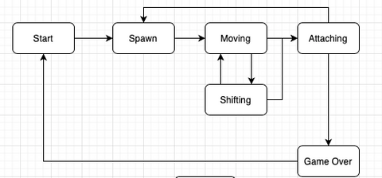

- Start is the state in which the game waits for the player to press the ready button.
- Spawn is the state the game enters when you create another block and select the next block to spawn.
- Moving is the main game state with user input processing — rotating blocks/moving blocks horizontally.
- Move is the state the game enters after the timer runs out. It moves the current block down one level.
- Attaching is the state the game enters after the current block "touches" the already fallen blocks or the ground. If full rows are created, they are destroyed and the remaining blocks are moved down. If a block is stopped in the top row, the game enters the "game over" state.
- Game over is the end of the game.

## Chapter II
## Project Requirements

### Part 1. Main task

Implementation of the BrickGame v1.0 aka Tetris program:

- The program must be developed in C language of the C11 standard using the gcc compiler.
- The program must consist of two parts: a library implementing the logic of the Tetris game, and a terminal interface using the `ncurses` library.
- A finite state machine must be used to formalize the logic of the game.
- The library must have a function that accepts user input and a function that outputs a matrix describing the current state of the playing field whenever it is changed.
- The library code must be placed in the `src/brick_game/tetris` folder.
- The program interface code must be in the `src/gui/cli` folder.
- The program must be built using a Makefile with the standard set of targets for GNU programs: all, install, uninstall, clean, dvi, dist, test, gcov_report. The installation directory can be arbitrary.
- The program must be developed according to the principles of structured programming.
- Follow Google Style for C++ when writing code.
- Prepare full coverage of the library with unit tests, using the `check` library (tests must run on Darwin/Ubuntu OS). The coverage of the library with game logic with tests must be at least 80 percent.
- The following mechanics must be present in the game:
  - Rotation of pieces;
  - Horizontal movement of pieces;
  - Acceleration of the piece's fall (when the button is pressed, the piece moves all the way down);
  - Displaying the next piece;
  - Destruction of filled rows;
  - End of the game when the top of the board is reached;
  - All types of pieces shown in the picture below must be included in the game.
- Add support for all buttons provided on the physical console for control:
  - Start game,
  - Pause,
  - End game,
  - Left arrow — move the piece to the left,
  - Right arrow — move piece to the right,
  - Down arrow — piece falls,
  - Up arrow is not used in this game,
  - Action (piece rotation).
- The playing area must be the same size as the console's playing field — ten "pixels" wide and twenty "pixels" high.
- When the figure reaches the lower boundary of the board or touches another figure, it must stop. After that, the next piece, shown in the preview, is generated.
- The library interface must match the description down below.
- The UI must support rendering of the playing field and additional information.
- Prepare a diagram in any format describing the FSM used (its states and all possible transitions).

Pieces used:  

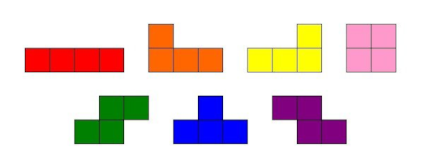

### Part 2. Bonus. Scoring and game record

Add the following mechanics to the game

- Scoring;
- Store maximum score.

This information must be passed and displayed by the user interface in the sidebar. The maximum score must be stored in a file or an embedded DBMS and saved between program runs.

The maximum score must be changed during the game if the user exceeds the current maximum score.

Points are accumulated as follows:

- 1 row is 100 points;
- 2 rows is 300 points;
- 3 rows is 700 points;
- 4 rows is 1500 points.

### Part 3. Bonus. Level mechanics

Add level mechanics to the game. Each time a player earns 600 points, the level increases by 1. Increasing the level increases the speed at which the pieces move. The maximum number of levels is 10.

## Chapter III
## Realization

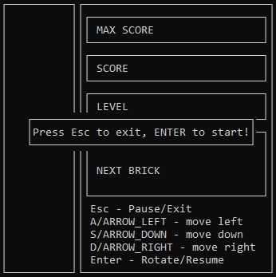 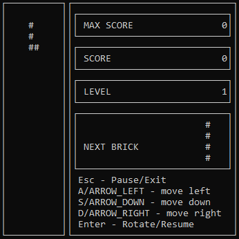 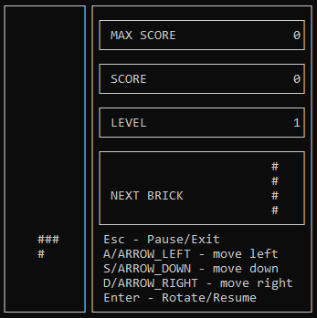

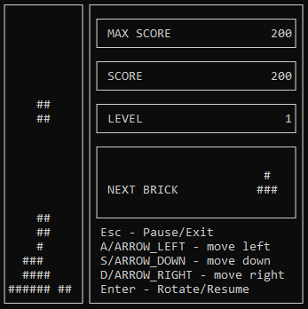 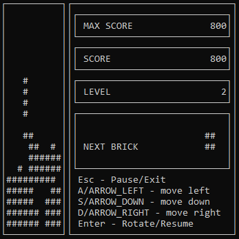 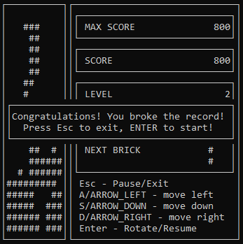

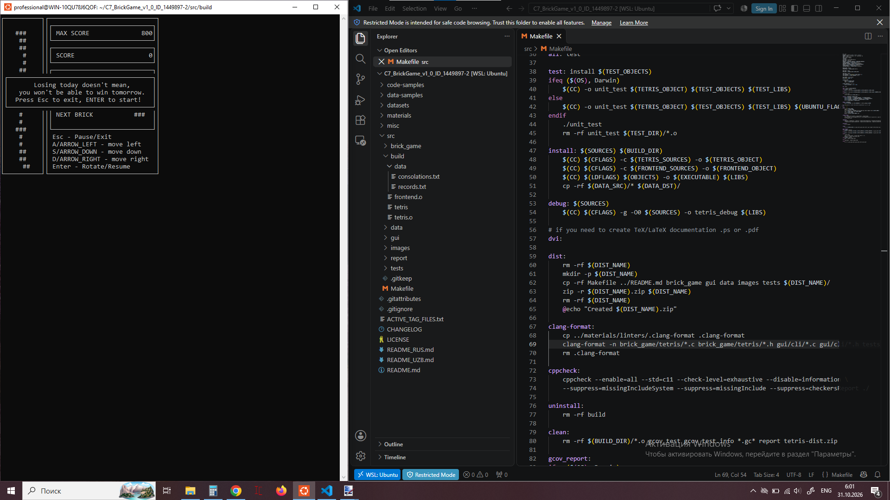

tests - 90,9% coverege:

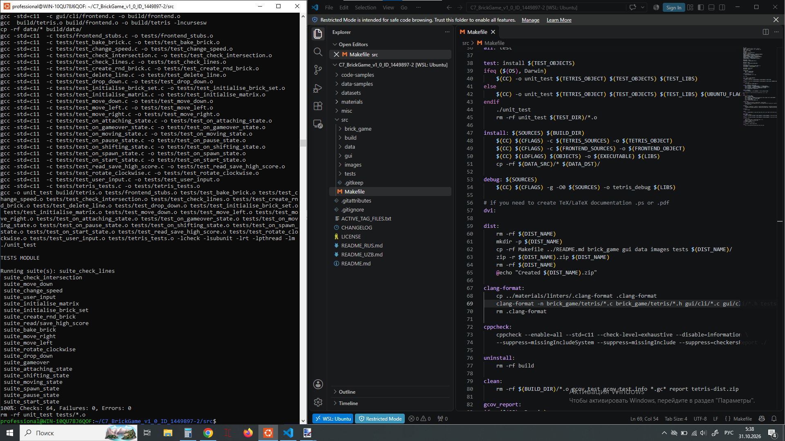

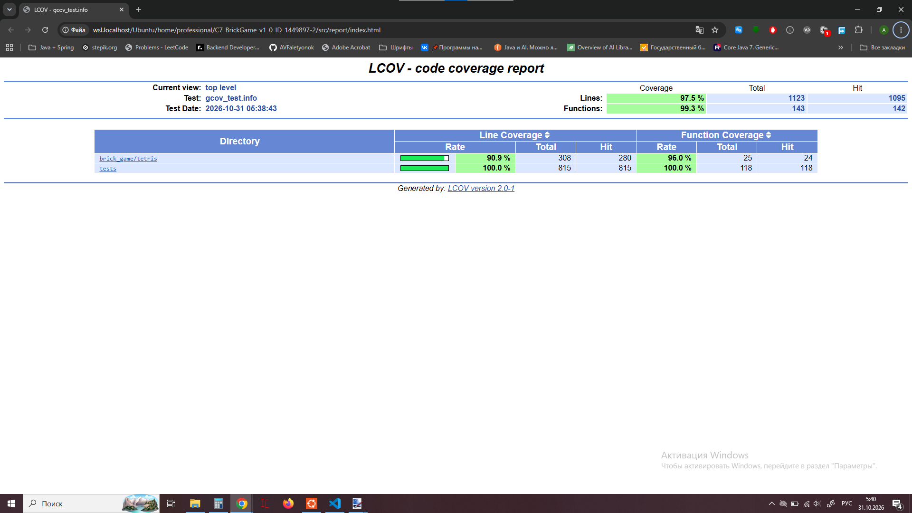
clang-format:

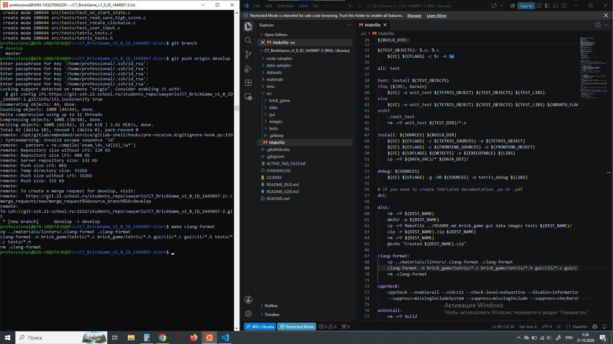

cppcheck:

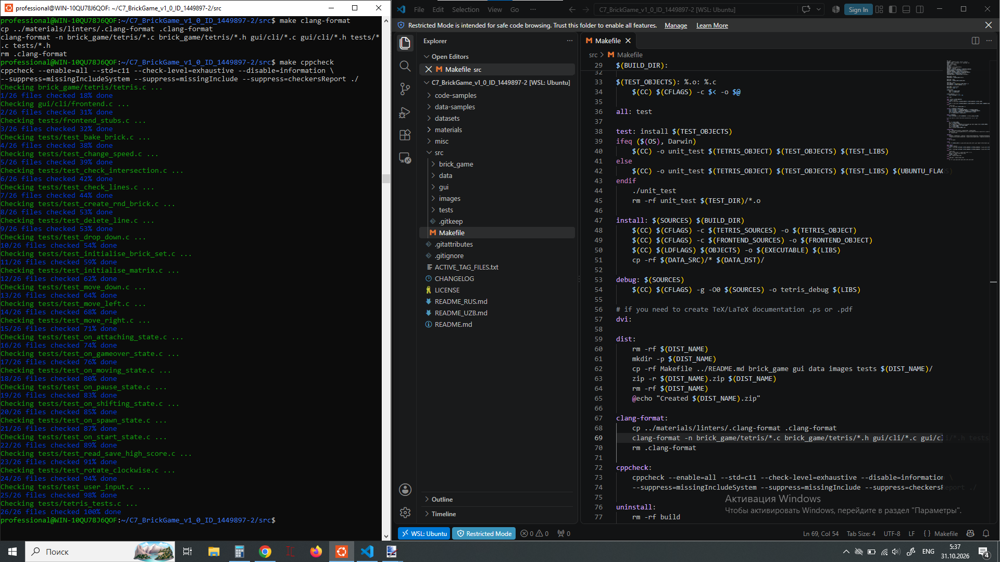